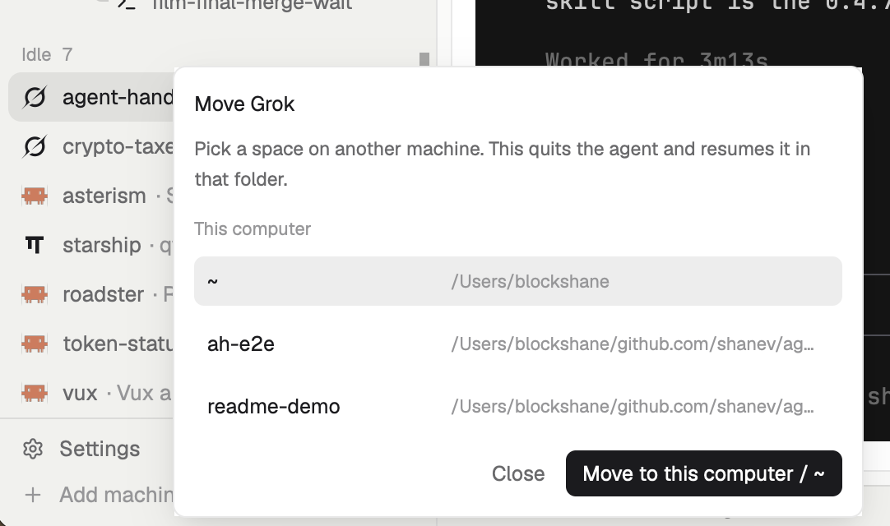

# agent-handoff

[](https://github.com/shanev/agent-handoff/actions/workflows/test.yml)

Move a running coding-agent session to another machine and keep going there.



It moves Claude Code, Codex, omp (oh-my-pi), pi, grok, and OpenCode. Any agent that supports [skills](https://skills.sh) can do the moving, including moving its own session after the current turn ends.

Tell it what you want:

> Hand off my hark Claude session to vega.

> Move the codex agent in modelrelay over to the mini.

> Bring the session that's running on vega back here.

> Move yourself to vega once this turn ends.

It quits the agent, sends the branch and your uncommitted changes straight to the other machine over SSH, copies the transcript with the paths rewritten, and resumes that same session in an [hc](https://herdr.dev/core/) terminal. OpenCode sessions are exported and imported, since they share one database. When the Herdr app is open on the target, the session is put in a space for that folder. Uncommitted changes are stashed where the session left, labelled `agent-handoff`. If the resume fails, the agent is restarted where it was.

On one machine, ask it to move the session into a new worktree or another checkout. Same steps, no SSH.

## Install

On each machine you hand sessions off from:

```bash
npx skills add shanev/agent-handoff -g
```

## Requirements

On both machines: [hc](https://herdr.dev/core/) 0.1.13 or newer, with `hc server` running and the agent in an hc terminal; `python3` 3.9+, `git`, `ssh`, and `tar`; the agent's CLI on the interactive shell PATH and logged in; a clone of the repo with a git remote.

Between them: SSH that works with `ssh -o BatchMode=yes <host> true`, both ways if you want the session back. If the other machine would reach this one by the wrong name, set `AGENT_HANDOFF_SELF=user@host`. Codex's sandbox blocks the network and other agents' session folders, so approve the handoff script outside the sandbox.

The procedure, the prompts, and the limits are in [`skills/agent-handoff/SKILL.md`](skills/agent-handoff/SKILL.md). Every flag: `python3 skills/agent-handoff/scripts/agent_handoff.py send --help`.

## Herdr

Right-click an agent and pick a space on another machine. The agent quits and resumes in that space's folder.

```sh
python3 herdr/handoff/wire.py
```

That installs `herdr/handoff/` and adds the right-click to a copy of Herdr's agent list. The script has to be installed on the machine where Herdr is running. Set `AGENT_HANDOFF` to its path if it lives somewhere else.

## Tests

```bash
python3 -m unittest discover -s tests
```

## License

MIT
